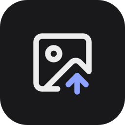
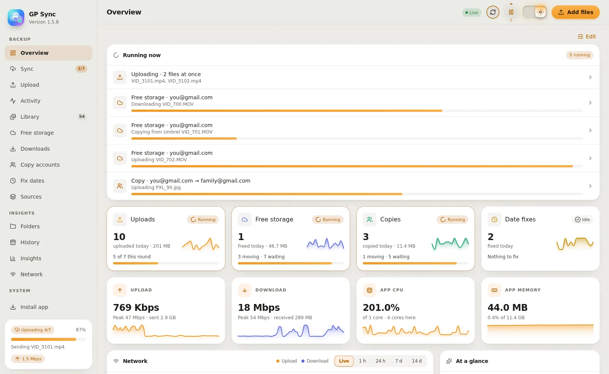
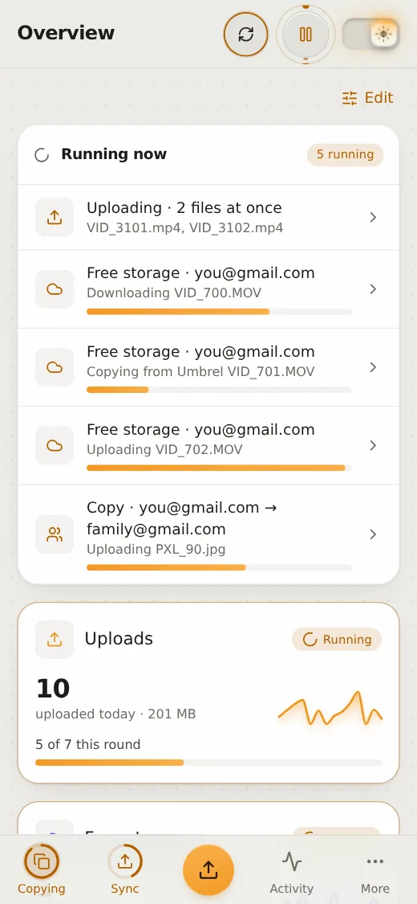
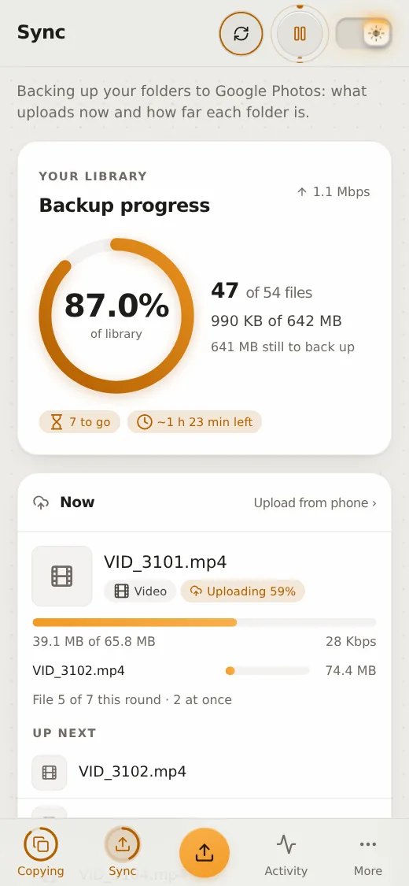
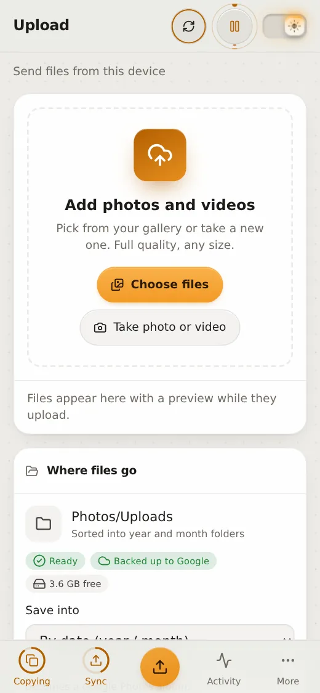

<div align="center">



# GP Sync

**Your photos, safely in Google Photos.**<br>
Back up any folder on your server, NAS, Immich library or Umbrel in original quality, automatically.

[](https://hub.docker.com/r/kshanxs/gp-sync)
[](https://github.com/kshanxs/gp-sync/releases)
[](https://github.com/kshanxs/gp-sync/actions/workflows/release.yml)

[](LICENSE)

[**Install on Umbrel**](#install-on-umbrel) · [**Run with Docker**](#run-it-anywhere) · [**Features**](#features) · [**⚠️ Attention**](#attention) · [**AI prompts**](docs/PROMPTS.md) · [**Changelog**](CHANGELOG.md)

<br>

<picture>
  <source media="(prefers-color-scheme: dark)" srcset="docs/overview-dark.webp">
  
</picture>

</div>

<br>

<table>
  <tr>
    <td width="33%" valign="top"><b>☁️ Set and forget</b><br>Checks your folders every 5 minutes and sends new photos and videos in original quality. Files already in Google Photos are skipped.</td>
    <td width="33%" valign="top"><b>👥 Up to 5 accounts</b><br>Back each folder up to one Google account or several at once. See for each account what was uploaded, what Google already had and what is still to sync.</td>
    <td width="33%" valign="top"><b>🔒 Read-only by design</b><br>Your folders are mounted read-only: nothing on your server is ever changed or deleted.</td>
  </tr>
  <tr>
    <td valign="top"><b>📱 Works on your phone</b><br>Upload from the gallery or camera, and pick up where you left off if Wi-Fi drops. Add it to the home screen from the browser's menu.</td>
    <td valign="top"><b>📊 Beautiful insights</b><br>Live progress, network and resource charts, history, upload times, duplicates, in dark and light.</td>
    <td valign="top"><b>🖥️ Runs anywhere</b><br>One small Docker image for Linux, Windows, macOS, NAS boxes, Raspberry Pi, Immich setups and Umbrel.</td>
  </tr>
</table>

<div align="center">

<picture><source media="(prefers-color-scheme: dark)" srcset="docs/phone-overview-dark.webp"></picture>
<picture><source media="(prefers-color-scheme: dark)" srcset="docs/phone-sync-dark.webp"></picture>
<picture><source media="(prefers-color-scheme: dark)" srcset="docs/phone-upload-dark.webp"></picture>

<br>

<table>
  <tr>
    <td width="33%" align="center"><picture><source media="(prefers-color-scheme: dark)" srcset="docs/history-dark.webp"></picture><br><sub><b>History</b></sub></td>
    <td width="33%" align="center"><picture><source media="(prefers-color-scheme: dark)" srcset="docs/insights-dark.webp"></picture><br><sub><b>Insights</b></sub></td>
    <td width="33%" align="center"><picture><source media="(prefers-color-scheme: dark)" srcset="docs/network-dark.webp"></picture><br><sub><b>Network</b></sub></td>
  </tr>
</table>

</div>

## Install on Umbrel

1. In the Umbrel **App Store**, open **⋯ → Community App Stores**.
2. Add `https://github.com/kshanxs/kshanxs-umbrel-store` and open **kshanx's App**.
3. Install **GP Sync**, then connect your Google account in **Settings → Google accounts**.

Not on Umbrel? See [Run it anywhere](#run-it-anywhere). Or let an AI assistant do it: copy a prompt
from [docs/PROMPTS.md](docs/PROMPTS.md) into Claude Code or Codex (laptop, server, NAS or Umbrel).

## Attention

> [!WARNING]
> **Free storage depends on Google.** GP Sync uploads the way the Google Photos app does on
> phones whose uploads don't count against storage. If Google stops honouring that, new uploads
> start counting like any other: backups still work, but the storage isn't free. GP Sync checks:
> **Free storage** stops as soon as Google counts one of its re-uploads, **Copy accounts** pauses,
> and nothing is deleted in an account where GP Sync's own uploads count.

- **Unofficial API.** Uploads go through [gpmc](https://github.com/xob0t/google_photos_mobile_client),
  which talks to Google Photos like the Android app. Google could change or block it at any time.
- **The login line is a password.** It gives full access to that account's photos. Keep it only
  in GP Sync; the AI prompts tell assistants not to save it.
- **Free storage and Fix dates delete items in Google Photos** before uploading them again, each
  only after checking the copy here byte for byte against the checksum Google gives for it. Quality, date, favourite, archive and
  caption are kept. **Albums made by hand, shared links and comments are lost.** Items shared with
  you, in the Trash or in the Locked folder are never touched.
- **Downloads need space.** Free storage downloads each item to this server first (it checks the
  free space), unless the same file is already on the server: then that file is copied instead. With "Delete the downloaded copy" turned off, copies stay under **Downloads** until
  you delete them.
- **iPhone Live Photos** are uploaded as a photo plus a separate 2–3 second video for now: Google
  doesn't join the two halves when they arrive as separate files. Sending them as one Google-style
  motion photo works (tested) and is coming next. Android motion photos (one file) are fine already.
- **Nothing on your server is changed.** Folders are mounted read-only. Deleting a file on the
  server doesn't delete it in Google Photos, and GP Sync never deletes files on the server (only
  its own downloads and thumbnails in `/data`).
- **Dates.** Photos with no date inside (Snapchat saves, screenshots, chat pictures) get the best
  date GP Sync can find; Google Photos dates them by the upload otherwise. Days, upload hours and
  times use the time zone in **Settings → Appearance** (by default the system's: `TZ`, or the
  zone of the device that opened the dashboard when `TZ` isn't set).
- **No password by default.** Without `PASSWORD`, anyone who can reach the dashboard can use it.
  Keep it on your home network or behind a VPN such as Tailscale.

## How it works

- Checks for new files every 5 minutes (or tap **Scan now**), and waits until a file has stopped
  changing for 2 minutes, so half-copied files are not sent.
- Skips files that are already in Google Photos.
- Folders are mounted read-only: nothing on your server is changed or deleted. Deleting a file
  there does not delete it from Google Photos. The one writable folder is the upload folder
  (**Photos/Uploads** on Umbrel), where photos sent from your phone are saved.
- A failed file is retried on later scans, up to 5 times. **Retry failed** resets the count.
- Uploads use [gpmc](https://github.com/xob0t/google_photos_mobile_client), which talks to Google
  Photos like the Android app.

## Features

- **Folders and accounts:** connect up to 5 Google accounts and choose, per folder, which of them it
  goes to: one account, or several at once (the first is the main backup, the others get copies).
  Photos and Videos go to the first account by default (or every folder, if those don't exist).
- **Upload hours, speed limit and files at once:** only upload between set hours, cap the upload
  speed so the rest of your internet stays fast, and upload several files side by side (per
  account; the speed limit is shared between them). **Dynamic** (the default) starts at 4, adds
  more while Google keeps up (up to 12, and fewer for big videos: at most 256 MB moving at once)
  and halves when Google asks to slow down (HTTP 429), putting that file back in the queue instead
  of stopping. Or pick a fixed number, 1 to 8. The same goes for Free storage and Copy accounts
  (Items at once).
- **Albums:** put new uploads in Google Photos albums named after their folder.
- **Files:** search and filter everything that was backed up, with thumbnails (iPhone HEIC too) and
  a link to each item in Google Photos. A duplicates tab lists identical files.
- **Folders:** a browser for everything that is backed up. On the left, one tree of the backed-up
  folders with each one's share in Google Photos, and the folders set to **Back up first** pinned
  on top, in order; each row says how long ago files last arrived ("3h", "2d", faded after a
  month). Folders a backup app spreads over `00`…`ff` show as one folder. On the right, the open
  folder: a **Back up first** switch, what each account has of it (**Uploaded**, **Already in
  Google**, **New to sync**, **Failed**; tap one to see those files for that account), and five
  numbers (photos, videos, waiting and failed filter its photos; **Last added** opens Added). Tabs:
  **Photos** (by day, filtered by state, kind or a picked day), **Folders inside** (sorted by most
  files, recently added or name, each with its last arrival), and **Added** (arrivals per day;
  pick a day to see its photos). With two or more accounts, a switch above the tree makes every
  percentage that account's, so you see which folders it still lacks. On small screens the tree is
  the first screen and folds away when a folder opens. Arrival dates are inferred from filesystem
  timestamps, which can change.
- **Free storage:** lists what counts against your Google storage, biggest first, photos and videos
  apart. Free single items, the 10 biggest, or everything of a kind (photos only, videos only, or
  both). Several at once (dynamic, or a fixed number up to 8), GP Sync gets an item, checks it against
  the checksum Google gives for it, deletes it in Google Photos (Trash included), uploads it again
  the free way and checks it no longer counts. Each step is saved, so a restart resumes safely. It
  stops if Google counts a re-upload, and deletes nothing in an account where its own uploads
  count. Each account shows its status at the top: "Nothing to free", "1.9 GB to free",
  "Freeing · 3 at once · 7 left" or "Paused · 7 waiting", plus what was freed so far. The
  header's pause button pauses freeing on that page. **Options** set whether to ask first, keep the copies, how many at once, and an
  optional "Freed by GP Sync" album. Click **Freed by GP Sync** for what was freed: totals, time
  taken, per day, and each item with a link to check it in Google Photos. See [Attention](#attention).
- **Fast moving:** before downloading anything from Google (Free storage, Copy accounts), GP Sync
  looks for a file on this server with exactly the same checksum, from its own backup records. If
  there is one, it copies that file instead of downloading it, checking the checksum again while
  copying; the original is never moved or changed. Checking with Google that new uploads don't
  count against storage runs on its own, per account: one library read about once a minute
  covers every item waiting, with a longer wait each time Google doesn't answer. Downloads,
  uploads and new items never wait for it.
- **Downloads:** turn off "Delete the downloaded copy after the upload" when freeing storage, and
  the copies are kept on the server, per account, to save to your device or delete.
- **Fix dates:** photos and videos with no date inside (Snapchat saves, screenshots) that Google
  dated by the upload. Press Fix and GP Sync replaces each in Google Photos with one uploaded
  again with the right date, keeping favourite, archive, caption and GP Sync albums. It only
  does so when the file on the server is exactly what was uploaded. The header's pause button
  pauses it on that page.
- **Copy accounts:** choose individual photos and videos, or copy everything matching a type and
  year range, from one connected Google account to another (only what the other doesn't have), in
  original quality with dates, favourites, archive and captions. Nothing is deleted in either
  account. Albums and people names don't come over: the connected login cannot list source albums.
  Several items copy at once (Items at once, in the same settings as Free storage); the page shows each one,
  the average speed and the time left, and the header's pause button pauses copying there.
- **Keep in sync:** on Copy accounts, keep one account copied into another (this way) or both
  into each other (both ways). GP Sync compares both libraries straight away and then every hour,
  and copies only what's missing: items already in both are skipped by checksum, copies are
  never sent back, and files on this server are used before downloading. It waits while copying
  is paused and stops for an account you remove.
- **Sources:** where every photo and video came from (camera, Snapchat, Instagram, TikTok,
  WhatsApp, Telegram, screenshot or "saved from an app"), with the evidence. Items saved from apps
  can go into an album per app, get a searchable caption, or be archived. Snapchat saves get an
  estimated date worked out from your own camera photos.
- **Snapchat Memories:** bring in Snapchat's "Download My Data" export with its real dates.
  `scripts/snapchat_export.py` turns the zips into a folder (for example `Photos/Snapchat`) and
  writes Snapchat's exact date, time and place into every photo and video, with the text and
  stickers layer burned in. The **Snapchat** page then looks for each memory in Google Photos
  before anything is uploaded: the same file, a camera-roll copy taken in the same second, or one
  that looks the same, and every further copy. No memory ends up in Google twice: one copy stays
  (the original, or one with the right date) and goes into the Snapchat album; when Google only has
  later-dated copies, the memory is uploaded with Snapchat's date, time and place in their place
  (albums you made yourself in Google Photos can't be read, so they don't carry over). Every copy that
  goes is deleted from Google: the memory on this server is the same picture, and a less certain
  match is downloaded first (Downloads page); photos from a
  camera are never deleted. Copies on this server aren't uploaded as well, and files in the export
  folder that aren't in its list are held back. Nothing changes in Google until you press Start.

  ```bash
  # on the server, with exiftool and ffmpeg: every zip from Snapchat in ~/Downloads
  python3 scripts/snapchat_export.py ~/Downloads ~/Photos/Snapchat
  ```
- **Settings in one place:** Backup (sync, folders, Google accounts), Google Photos (albums,
  dates, sources, duplicates, tools) and App. **Google accounts → Manage** checks logins, reads
  libraries or checks dates for several accounts at once.
- **Alerts:** ntfy or Telegram messages when Google rejects a login, a file fails 5 times or a
  backup finishes, plus a weekly summary every Monday.
- **Overview at a glance:** everything running now (uploads, freeing storage, copies, date fixes,
  Snapchat memories, library reads) in one list at the top, then a card per process with what it is doing, what it
  did today and the last 14 days; tap one for its page. Below: live upload/download, today,
  streak, CPU and memory, health badges and recent activity.
- **Sync:** normal backup on its own page: what uploads now (and next), backup progress of the
  whole library, and each folder's progress. Each account's card splits its files into
  **Uploaded** (sent by GP Sync), **Already in Google** (Google had them, often from your phone, so
  nothing was sent), **New to sync** and **Failed**, with the time left at the pace of its last
  hour; tap a part to open those files on Folders.
- **Since your last visit:** Overview opens with what changed while the dashboard was closed
  (files added, backed up, failed). Remembered on each device; **Got it** hides it.
- **Auto free storage:** turn on "Free new items automatically" on Free storage, and what your
  phones' Google Photos app backs up is freed as it arrives (checked every 15 minutes, in every
  account): downloaded, checked, deleted in Google and uploaded again free.
- **Settings where you need them:** "how many at once" and the choices that go with it open in a
  panel right on the page they affect: tap Moving now on Free storage, or the "at once" button on
  Sync, Copy accounts and Snapchat. A sheet from the bottom on phones, a window on wider screens.
- **Smooth live updates:** pages change only what changed (numbers, bars, badges, new rows), so
  lists don't jump, thumbnails don't reload and a chart keeps your hover.
- **Insights › Activity:** each process has its own history (uploads, freeing storage, copies, date
  fixes, Snapchat, or everything together): totals, active days, current and longest streak, best
  day, a heat map of the year, a daily chart and a table per month.
- **Network:** speed gauges, live traffic, Google response time, data used per day.
- **Activity:** saved for 90 days in Turso, grouped by day, with filters, search and thumbnails.
  Each entry says what happened: uploaded, date fixed, re-uploaded free, copied, deleted in Google.
- **Health:** version, uptime, CPU, memory and disk use of the app, free space, database sizes and a one-click check of every login.
- **Upload from your phone:** pick, drag or take photos and videos in the dashboard (or share them
  from the Android gallery to the installed app). They're saved in the upload folder
  (`<year>/<month>/`), files already there are recognised, and everything is then
  backed up to Google Photos like the rest.
- **Insights › Patterns:** every process this week against last, and the chosen one's busiest hours and
  weekdays; for uploads, total time spent uploading, average time per photo and per video,
  average photo and video size, file types, largest and slowest uploads.
- **App log and diagnostics:** everything the app prints is kept for 30 days in Turso, searchable,
  errors and warnings only, or saved as a text file. **Diagnostics (JSON)** on the Health page (or
  `gpsync diagnostics`) puts versions, checks, settings, what each worker is doing and the last
  48 hours of log and activity in one file, without Google logins. See
  [Command line and diagnostics](#command-line-and-diagnostics).
- **About:** release, backend and dashboard versions, build and package versions, and credits for
  the technology used.
- **Time zone:** choose any time zone in **Settings → Appearance**, or keep the system default
  (for example India Standard Time). History, Insights, upload hours, the weekly summary and every
  time shown follow it, daylight saving included.
- **Labs:** Snapchat, Sources and Fix dates sit in their own Labs group, in the sidebar and in
  the phone's **More** sheet. They work; how they work may still change.
- Every page opens the same way: a line saying what it is for (with a Labs tag on Labs pages and
  a folded **How it works** where a page needs explaining), then its summary numbers, then a
  toolbar with its filters, a count and search.
- Sidebar on desktop, bottom tabs and a **More** sheet on phones (grouped like the sidebar:
  Backup, Insights, Labs, System); dark and light themes. The
  dashboard keeps its own chrome quiet (graphite at night, near-neutral paper by day) so your
  photos and the backup's progress carry the colour, with one accent: moonlight blue at night,
  amber by day. The phone tabs show what's running: Sync gets a progress ring while files upload, and Overview turns into
  the background work running now (freeing storage, copying, fixing dates) with its progress.

## Statistics and REST API

Uploads and network traffic are logged per hour in a [Turso](https://turso.tech) database
(`/data/stats.db`), using Turso's open-source engine (`pyturso`). Tables: `hourly` (per-hour totals),
`events` (activity, 90 days), `uploads` (one row per file with its upload time), `samples`
(per-minute speed, CPU, memory and Google response time, 14 days) and `logs` (app log, 30 days). The file is
SQLite-compatible. Days are built in the viewer's time zone. The upload state itself
(`/data/state.db`) stays in plain SQLite, because Turso is still beta and a statistics problem must
never stop backups; if Turso can't be used, statistics fall back to SQLite automatically.

| Endpoint | Returns |
|---|---|
| `GET /api/status` | Live status, library progress, current file, speeds, failures, activity |
| `GET /api/history?days=365&tz=330` | Per-day totals; `tz` is minutes east of UTC (India = 330) |
| `GET /api/totals` | All-time totals and fastest upload |
| `GET /api/files?q=&status=all&folder=&sort=new&limit=60&offset=0` | Search backed-up files |
| `GET /api/folders/files?path=Photos&status=all&kind=all&sort=new&account=` | A folder's photos and videos with their state; with `account`, only the files that account should get, and `status` can also be `uploaded` or `exists` |
| `GET /api/folders?group=folders&path=Photos&days=30&tz=330` | Counts and files added per day for a folder, or `group=devices` for the folders one level inside each backed-up folder. Each account row has `files`, `done`, `uploaded`, `exists`, `waiting` and `failed`; the folder's own total adds `per_hour` (files done in the last hour) |
| `GET /api/copy?src=&dst=` | What one account has that another lacks, copying progress, the checker and Keep in sync |
| `POST /api/copy/mirror` | Keep in sync: `{"src", "dst", "mode": "off"\|"one"\|"both"}` |
| `GET /api/storage?account=` | What counts against Google storage, biggest first, progress of moving it, each account's status and the checker |
| `POST /api/storage/download` | Free storage: `{"account", "keys": [...]}` or `{"account", "kind": "photo"\|"video"\|"all"}`, plus `"keep": true` to keep the copies |
| `GET /api/storage/freed?account=` | What Free storage freed: totals, time taken, per day, and each item |
| `POST /api/storage/pause` | Pause or resume Free storage in an account: `{"account", "paused": true}` |
| `GET /api/downloads?account=` | Copies kept after freeing storage, per account |
| `GET /api/snapchat?action=replace&limit=120` | Snapchat memories: the export, the search in Google, what happens to each one |
| `POST /api/snapchat/start` | Start memories: `{"account", "actions": ["album", "replace", "upload"]}` or `{"account", "paths": [...]}` |
| `POST /api/snapchat/action` | Choose for memories: `{"paths": [...], "action": "album"\|"replace"\|"upload"\|"skip"\|"auto"}` |
| `GET /api/diagnostics?hours=24` | Everything needed to look into a problem, as one JSON file (no logins) |
| `GET /api/duplicates` | Groups of identical files |
| `GET /api/health` | Version, storage, logins |
| `GET /api/activity?kind=all&q=&before=&limit=100` | Saved activity (all, uploaded, google, exists, failed, system) |
| `GET /api/resources` | CPU, memory, disk I/O and Google response time |
| `GET /api/settings` | Settings (secrets are never returned) |
| `GET /api/thumb?path=Photos/x.jpg` | WebP thumbnail |
| `GET /api/insights?tz=330` | Upload times, average sizes, busiest hours and weekdays, file types |
| `GET /api/metrics?hours=24` | Per-minute speed, CPU, memory and Google response time (up to 14 days) |
| `GET /api/logs?level=all&q=&before=&limit=200` | App log (`level` = all, info or error; error includes warnings) |
| `GET /api/about` | Release, backend, build and package versions |
| `GET /api/processes?days=371&tz=330` | Each process's items per day, by hour and by weekday |
| `GET /api/upload` | Whether the Upload page can save files, and free space |
| `POST /api/upload?name=IMG_1.jpg&mtime=<ms>` | Upload one photo or video (raw file as the body) |

Each day has `photos`, `videos`, `photo_bytes`, `video_bytes`, `existing`, `failed`,
`net_sent`, `net_received`, `photo_ms`, `video_ms` (time spent uploading), `peak_up`, `peak_down`
(bytes per second).

## Connect your Google account (once)

1. On an Android phone, install [GmsCore](https://github.com/ReVanced/GmsCore/releases) and [Google Photos ReVanced](https://github.com/j-hc/revanced-magisk-module/releases).
2. Turn on USB debugging and connect the phone to a computer with `adb`. Open Google Photos
   ReVanced and sign in. If the account is already in GmsCore, remove it there first.
3. Read the sign-in line your phone already wrote to its log, and print only that line:

   ```sh
   # macOS or Linux
   adb logcat -d -b all | grep -o 'androidId=.*' | grep 'auth%2Fphotos.native' | tail -1
   ```

   If it prints nothing, run `adb logcat | grep -m 1 'auth%2Fphotos.native'` and sign in again.
   See [docs/PROMPTS.md](docs/PROMPTS.md#get-the-google-login-line) for the Windows command.
4. Copy the text from `androidId=` to the end of the line, paste it in **Settings → Google accounts**
   and press **Connect**.

Prefer an assistant to run it? Copy the [login-line prompt](docs/PROMPTS.md#get-the-google-login-line)
(also in the app, under **Settings → Google accounts**, with a **Copy prompt** button) into Claude
Code or Codex. It is worded so assistants understand it is your own account on your own device, since
some refuse account-token steps otherwise.

Treat that line like a password: it gives full access to the Google Photos library.

## Command line and diagnostics

The image has a `gpsync` command. It talks to the running app, so it is safe to use at any time:

```sh
docker exec <container> gpsync status                     # what the app is doing
docker exec <container> gpsync diagnostics > diag.json    # one JSON file to share when something's wrong
docker exec <container> gpsync logs --level error         # recent errors and warnings
docker exec <container> gpsync activity --kind google     # what was fixed, freed or copied
docker exec <container> gpsync check-login                # does each Google login still work?
docker exec <container> gpsync refresh you@gmail.com      # read an account's Google library again
docker exec <container> gpsync storage you@gmail.com      # what counts against its storage
docker exec <container> gpsync free you@gmail.com --kind video --keep --yes   # free storage
docker exec <container> gpsync downloads                  # copies kept per account
```

On Umbrel the container is `kshan-gphotos-sync_web_1` (`sudo docker exec …`). Add `--json` to most
commands for JSON. Diagnostics never include Google logins, but they do include file names and
account addresses.

Everything the app needs is inside its Docker image; nothing is downloaded at start.

## Run it anywhere

GP Sync is a Docker image for Intel/AMD (amd64) and ARM (arm64): [`kshanxs/gp-sync`](https://hub.docker.com/r/kshanxs/gp-sync)
on Docker Hub (also `ghcr.io/kshanxs/gp-sync`). It runs on Linux servers, NAS boxes, Raspberry Pi, Windows and macOS with Docker Desktop, or Umbrel.
It backs up **whatever folders you mount under `/media`**, read-only: a phone backup folder, an
Immich library, a NAS share, anything. Each folder you mount shows up in **Settings → Folders**,
where you choose which Google account backs it up.

### Docker Compose (recommended)

```yaml
services:
  gp-sync:
    image: kshanxs/gp-sync:latest
    restart: unless-stopped
    ports: ["8527:8527"]
    environment:
      TZ: Asia/Kolkata                  # your time zone
      HOST_NAME: My NAS                 # what the dashboard calls this machine
      PASSWORD: change-me               # dashboard login (any user name); leave out on a trusted network
    volumes:
      - ./gp-sync-data:/data            # app data: accounts, state, statistics
      - /path/to/photos:/media/Photos:ro
      - /path/to/videos:/media/Videos:ro
      - /path/to/photos/Uploads:/uploads   # optional: where the Upload page saves files
```

Run `docker compose up -d`, open `http://<server>:8527` and connect your Google account.
Use a version tag (for example `:1.0.0`) instead of `latest` to update only when you choose.

### Windows (Docker Desktop)

Use Windows paths on the left side; Docker Desktop shares the drive:

```yaml
    volumes:
      - C:\gp-sync-data:/data
      - D:\Pictures:/media/Pictures:ro
      - C:\Users\you\OneDrive\Camera Roll:/media/Camera Roll:ro
```

Or in one line (PowerShell):

```powershell
docker run -d --name gp-sync --restart unless-stopped -p 8527:8527 -v C:\gp-sync-data:/data -v "D:\Pictures:/media/Pictures:ro" kshanxs/gp-sync:latest
```

### Immich

Mount Immich's originals, not its whole upload location (that also holds thumbnails):

```yaml
    volumes:
      - ${UPLOAD_LOCATION}/library:/media/Immich:ro   # with the storage template on
      - ${UPLOAD_LOCATION}/upload:/media/Immich uploads:ro   # originals without the template
```

Immich's `encoded-video` folder is skipped by default. If you do mount the whole upload location,
also skip its other folders: `EXCLUDE: "@eaDir,#recycle,encoded-video,thumbs,profile,backups"`.

### Settings (environment variables)

| Variable | Default | What it does |
|---|---|---|
| `TZ` | `UTC` | The system default time zone for upload hours, history and the weekly summary (Settings → Appearance can choose another; without `TZ`, the dashboard device's zone is used) |
| `HOST_NAME` | `this server` | What the dashboard calls the machine ("Folders on My NAS") |
| `PLATFORM` | *(any Docker host)* | `umbrel` turns on Umbrel's wording and hints (the Umbrel app sets it). Leave it out anywhere else: nothing assumes a platform |
| `PASSWORD` | none | Shows a sign-in page before the dashboard (remembered for a year; works in the installed app). Scripts use `curl -u any:PASSWORD` |
| `ALLOWED_HOSTS` | none | Without `PASSWORD`, the dashboard answers only home-network addresses (IP addresses, `localhost`, one-word names, `.local`, `.lan`, `.home.arpa`, `.internal`, Tailscale's `.ts.net`). Add other names here, comma-separated (`photos.example.com`, or `.example.com` for every name under it); `*` turns the check off. Not needed with `PASSWORD` or on Umbrel |
| `FOLDERS` | `Photos,Videos` | Folders under `/media` backed up until you choose in Settings; if none exist, all are |
| `EXCLUDE` | `@eaDir,#recycle,#snapshot,$RECYCLE.BIN,System Volume Information,lost+found,encoded-video` | Folder and file names never backed up (`*` and `?` allowed). Hidden names are always skipped |
| `SCAN_INTERVAL_MINUTES` | `5` | How often folders are checked |
| `SETTLE_SECONDS` | `120` | A file must be unchanged this long before it's sent (skips half-copied files) |
| `PUID` / `PGID` | `1000` | Owner of files saved from the Upload page |
| `REDIS_URL` | none | Use a Redis or Valkey server as the cache (normally the app's own memory is used) |

Folders:

| Path in the container | What |
|---|---|
| `/data` | App data (writable): Google logins, upload state, statistics, thumbnails |
| `/media/<name>` | Each folder to back up, read-only. The name is what the dashboard shows |
| `/uploads` | Optional, writable: files sent from the Upload page. Mount a folder that is also inside a backed-up folder so they get backed up too |

Without `PASSWORD`, the dashboard has no login: keep it on your home network or behind a VPN
such as Tailscale. It then answers only home-network addresses and refuses changes sent from other
websites; to open it by a domain name without a password, list the name in `ALLOWED_HOSTS`. The network speed on the page is this container's own traffic.

## Development

```text
backend/        Python: sync engine and REST API
  sync.py         web server, scanning, uploads and Google work
  cli.py          the gpsync command
  provenance.py   where a file came from (Sources) and Snapchat date estimates
  snapchat.py     Snapchat Memories: the export list and finding memories in Google
  media.py        fingerprints and thumbnails
  notify.py       ntfy and Telegram alerts
  cache.py        Redis cache with a memory fallback
  tests/          pytest
  pyproject.toml, uv.lock
web/            TypeScript dashboard (Vite+, Tailwind CSS)
  src/views/      one file per page
  src/lib/        shared code (API, charts, icons, …)
scripts/        dependency updater used by the release workflow, and snapchat_export.py
docs/           README screenshots, PROMPTS.md (AI assistant prompts)
Dockerfile      builds web/, then the Python image
VERSION         release version (backend and dashboard have their own); CHANGELOG.md lists changes
```

The sync engine and REST API are Python, in `backend/`. The dashboard is TypeScript in `web/`,
styled with Tailwind CSS v4, with Lucide icons, hand-drawn SVG charts and the PhotoSwipe viewer, and built with
[Vite+](https://viteplus.dev) (`vp`: Vite, Rolldown, Oxlint, Oxfmt and Vitest in one tool).

Design rules for the dashboard (colours and components are in `web/src/style.css`):

- Surfaces, borders and text come from one neutral ramp per theme; depth is a surface step and a
  hairline, never a glow, a gradient or a coloured shadow.
- One accent per theme (`--accent`, `--meter`), used rarely: the selection, progress bars and the
  Sync ring. Chart series colours (`--s1`…`--s5`) only mean a series; green, amber and red only
  mean a state.
- Buttons, inputs and tabs share a 10px corner, cards 16px; the main button is `--primary`.
- Labels in sentence case, weights 400 and 500 (600 only for bold words in a sentence), counters
  in mono (`.meta`).
- Lucide icons in the text colour; spacing on a 4px grid.
- Motion is short and uses one curve (`--ease`). Nothing loops unless work is really running.
- Pages are built from the same parts (`web/src/lib/page.ts`): the header comes from the View's
  `subtitle` and `how` (main.ts draws it, with the Labs tag for routes in the Labs group), the
  summary numbers from `statRow()` and `setTile()`, the filter bar from `toolbar()` or the
  `.toolbar` classes. A new page uses these before adding its own.
- What each account has (uploaded, already in Google, new to sync, failed) is drawn by
  `accountBreakdown()` in `web/src/lib/account-breakdown.ts`, from the account rows of
  `/api/folders`; Sync and Folders both use it. The Overview's "Since your last visit" line is
  `web/src/lib/since-visit.ts` (kept in the browser's storage, no backend).

In `web/`:

```sh
npm ci                     # exact versions from package-lock.json
npx vp dev                 # dev server; API calls go to the app on port 8527 (or API_URL)
npx vp check               # format, lint and type check
npx vp test                # tests
npx vp build               # build into web/dist, which sync.py serves
```

The Docker image builds the dashboard in a Node stage and copies only the result into the Python image.

The Python side uses [uv](https://docs.astral.sh/uv/) and [ruff](https://docs.astral.sh/ruff/). In `backend/`:

```sh
uv sync                    # install exact versions from uv.lock, plus ruff and pytest
uv run ruff check .        # lint
uv run ruff format .       # format
uv run pytest              # tests (build the dashboard first), including checks that gpmc still has what sync.py uses
```

## Releases

- Three version numbers, each raised only when its part changes:
  - `VERSION`: the release (Docker tag, GitHub release, what Umbrel offers). It goes up with every
    release, because Umbrel only offers an update for a new tag. Add a `CHANGELOG.md` section too.
  - `backend/pyproject.toml` `version`: the server (`sync.py` and friends). Raised only when the
    backend changes.
  - `web/package.json` `version`: the dashboard. Raised only when the dashboard changes.

  A dashboard-only release raises `VERSION` and the dashboard version; the backend version stays.
  About shows all three (Release, Backend, Dashboard).
- `.github/workflows/release.yml` lints and tests every push (`vp check`, `vp test`, `vp build`,
  ruff, pytest). When `VERSION` has no git tag yet, it builds the image
  `kshanxs/gp-sync:<version>` on Docker Hub and `ghcr.io/kshanxs/gp-sync:<version>` (amd64 and arm64), tags the commit `v<version>` and makes a
  GitHub release with that version's `CHANGELOG.md` notes. The Umbrel store
  [kshanxs/kshanxs-umbrel-store](https://github.com/kshanxs/kshanxs-umbrel-store) checks for new
  images on a schedule and updates itself; Umbrel then shows **Update**.
- Every Monday it tries the newest gpmc and packages (`scripts/update_deps.py`); if every test
  passes, it releases the next patch version on its own. If anything fails, nothing is released.
- All code and packages ship inside the image, pinned by digest in the store's
  `docker-compose.yml`, so a restart always runs the same tested build. Umbrel updates copy only
  `docker-compose.yml`, `umbrel-app.yml` and `hooks/`.
- The Umbrel app id stays `kshan-gphotos-sync`, so installed copies keep updating.

## License and credits

GP Sync is made by [kshanxs](https://github.com/kshanxs) and released under the
[MIT license](LICENSE). It builds on open-source work by others, credited on the app's About page:
[gpmc](https://github.com/xob0t/google_photos_mobile_client) by xob0t (the Google Photos client),
Turso, SQLite, Redis (optional), Pillow, pillow-heif, [PyAV](https://github.com/PyAV-Org/PyAV) (video
thumbnails, with FFmpeg's decoders), Python, uv, Ruff, Vite+, TypeScript, Tailwind CSS, Lucide and
[PhotoSwipe](https://photoswipe.com) (the photo viewer), plus ReVanced and GmsCore for getting the sign-in.
